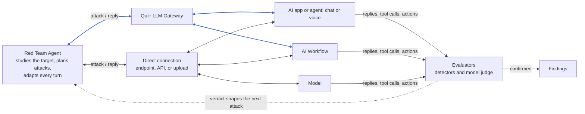

# How Quilr Red Teaming works

Quilr Red Teaming works like a human red teamer in a running conversation with the target. It plans an attack, reads the reply, judges the result, and uses what it learned to shape the next attack. Confirmed weaknesses become findings, and the cycle repeats on a schedule so testing keeps pace with changes to the target.

## Architecture

*Figure 1. Targets are reached through the Quilr LLM Gateway (blue) or directly (grey). Every reply and verdict shapes the next attack.*

## How an assessment runs

Every assessment moves through the same stages, in order.

1. **Connect.** You choose the mode and tell Quilr how to reach the target. See the guides under [Configure and run](../configure-and-run/agent.md).
2. **Choose coverage.** You pick a Quick scan, the Full library, or a custom selection, and add any custom objectives.
3. **Launch.** You record the authorized scope and confirm the authorization.
4. **Study the target.** Quilr first sends harmless requests to learn what the target does, then generates objectives aimed at its own tools. These appear as **Synthesized** in reports.
5. **Attack.** The Red Team Agent runs multi-turn attacks, reading each reply and choosing its next move.
6. **Evaluate.** Deterministic detectors and a model judge decide whether each attack Breached, Partially breached, or was Held. See [Risk grade and severity](../reference/risk-grade-and-severity.md).
7. **Report.** Findings get a severity, evidence, a recommended fix, and framework mappings, and the run gets a risk score and letter grade.
8. **Fix and replay.** The development team fixes the target, and you replay the findings to check that the attacks no longer work.

## Connection modes

| Mode | How attacks reach the target | Used by |
| --- | --- | --- |
| Through the gateway | Through the Quilr LLM Gateway, using the application's own key and policies. | AI apps, agents, and AI workflows that sit behind the gateway. |
| Direct | Straight to the target's own endpoint: an HTTP or WebSocket API, a voice endpoint, a document upload endpoint, or a model provider's API. | AI apps and agents, AI workflows, and models. |

You can leave the page while an assessment runs. Full turn-by-turn transcripts are shown only in the live run view; completed reports show turn-referenced evidence instead.
