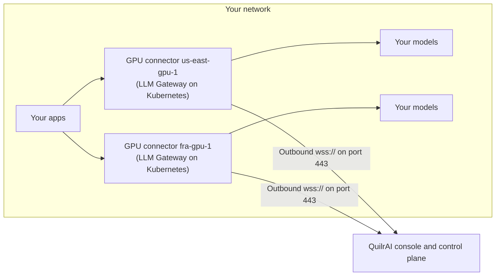

# GPU connectors

Run the LLM Gateway on your own GPU servers, for example one per data center or region. Each server is a **GPU connector** in the console. It connects out to QuilrAI with its own deployment ID and connector token, so it needs no inbound firewall rule. You then choose which providers run on which server.

## How it works



- **One installation per server.** You deploy the LLM Gateway on each server with the QuilrAI installer, as usual. A server becomes a GPU connector when you give it a deployment ID and a connector token.
- **Outbound only.** The server opens an encrypted WebSocket (`wss://`) connection to QuilrAI on port 443. QuilrAI never connects in to your network.
- **Your traffic stays local.** Your apps call the gateway on a server, and that server calls your models. These requests don't pass through QuilrAI.
- **You decide where each provider runs.** You link a provider to a server under **Network route** ([step 5](#5-link-providers-to-a-server)). When QuilrAI calls that provider, for example to list its models, run a test or run red teaming, the work runs on that server.

## Before you start

- **QuilrAI turns on GPU connectors for your organization.** Until then, the **GPU connectors** drawer shows **GPU connectors aren't available for your organization**.
- **Each server runs the LLM Gateway**, deployed with the QuilrAI installer by following the deployment guide from QuilrAI. Install it for exactly one tenant ID.
- **Each server can reach QuilrAI** on TCP port 443 over HTTPS and WebSocket (`wss://`). If a firewall or proxy sits in the path, it must allow WebSocket upgrades.
- **You have these console permissions:**

  | To do this | Access Control V2 | Legacy (V1) |
  |------------|-------------------|-------------|
  | See the **GPU connectors** drawer | **Read integrations** (`integrations.read`) | Integration > Instance > Read |
  | Add a server | **Create integrations** (`integrations.create`) | Integration > Instance > Create |
  | Edit, enable, disable or set the default server, or revoke a token | **Update integrations** (`integrations.update`) | Integration > Instance > Update |
  | Generate a token | **Update integrations** and **Reveal secrets** (`secrets.reveal`) | Integration > Instance > Update |
  | Delete a server | **Delete integrations** (`integrations.delete`) | Integration > Instance > Delete |
  | Link a provider to a server | Edit access to the provider, plus **Read integrations** | Edit access to the provider, plus Integration > Instance > Read |

  See [Roles and permissions](../../console/settings-organization/roles-and-permissions).

## 1. Add a GPU connector for each server

1. Go to **Settings > AI Gateway > LLM Gateway** and click **GPU connectors**.
2. Click **New GPU connector**.
3. Fill in the form:

   | Field | What to enter |
   |-------|---------------|
   | **ID** | The server's deployment ID, for example `us-east-gpu-1`. Use 1 to 63 lowercase letters, digits or hyphens, starting and ending with a letter or digit. It must be unique in your organization. You can't change it later or use it again, even after you delete the server. |
   | **Name** | A name shown on the card and in the provider's **Network route** list, for example `US East GPU 1`. |
   | **IP address** | Optional. The IP address or hostname that your provider base URLs use for this server's models. When a provider's base URL uses it, the console suggests this server. QuilrAI never connects to it. |
   | **Description** | Optional. Where the server runs or what it serves. |
   | **Make this the default server** | Optional. See [Where provider calls run](#where-provider-calls-run). Only one server can be the default. |

4. Click **Add GPU connector**.

The new card shows **Offline** until the server connects.

## 2. Generate a token for each server

1. On the server's card, click **Generate token**.
2. In the panel that opens, copy the **Deployment ID** and the **Connector token** (`qpc_<id>.<secret>`).
3. Click **Done**.

:::warning The token is shown only once
Save it in your secret manager. If you lose it, generate a new one. The connector token is not the master token you entered when you installed the gateway; the two are not interchangeable.
:::

## 3. Turn on the connector on each server

The installer already set your tenant ID, the QuilrAI URL and your master token. To turn the server into a GPU connector, add these values:

| Variable | Value | Per server |
|----------|-------|------------|
| `LLMGATEWAY_DEPLOYMENT_TYPE` | `PRIVATE`. Turns on the GPU connector. | Same on every server |
| `PRIVATE_DEPLOYMENT_ID` | The server's **ID** from step 1. Must match exactly. | Different |
| `PRIVATE_CONTROL_PLANE_CREDENTIAL` | The server's connector token from step 2. | Different |
| `SERVER_NAME` | Recommended. A label for this server in request logs and GPU monitoring. It doesn't have to match the ID, but give each server its own value. Without it, every server reports the installer's default name. | Different |

Run these steps from the installer folder, with `kubectl` pointing at the server's cluster. The commands use the installer's default names: the `quilr-service` namespace and the `quilr-workers-auth` Secret.

1. Save the connector token in the workers Secret:

   ```bash
   kubectl -n quilr-service patch secret quilr-workers-auth --type merge \
     -p '{"stringData":{"PRIVATE_CONTROL_PLANE_CREDENTIAL":"qpc_<id>.<secret>"}}'
   ```

2. Create a file named `gpu-connector.yaml` with the server's settings:

   ```yaml
   workers:
     extraConfig:
       LLMGATEWAY_DEPLOYMENT_TYPE: "PRIVATE"
       PRIVATE_DEPLOYMENT_ID: "us-east-gpu-1"   # must match the ID in the console
       SERVER_NAME: "us-east-gpu-1"             # any unique label; the ID is a simple choice
   ```

3. Apply it:

   ```bash
   ./upgrade-llm-gateway.sh --components workers -f gpu-connector.yaml
   ```

   Press Enter at the image tag prompt to keep the current version, then enter `y` to proceed. The script keeps your existing settings, adds these values and restarts the workers pod.

The restart makes that server's gateway unavailable for about 1 to 2 minutes. Repeat these steps on every server with its own ID and token.

:::note Keep these values in place
- Later runs of `upgrade-llm-gateway.sh` keep these values. If you run `install.sh` again, add `--llm-values gpu-connector.yaml` so they stay.
- Never use the same deployment ID on two servers.
:::

## 4. Check that each server is online

In the **GPU connectors** drawer, the card turns **Online (1 instance)** shortly after the workers pod is ready, and shows **Last heartbeat** and **Version**.

| Status | Meaning |
|--------|---------|
| **Online** | The server is connected and its gateway is healthy. |
| **Degraded** | The server is connected, but its gateway health check fails. |
| **Offline** | QuilrAI has no recent heartbeat from the server. |
| **Status unknown** | QuilrAI can't read the server's status right now. |

If a server stays **Offline**, read its connector log:

```bash
kubectl -n quilr-service exec deploy/quilr-workers -- \
  gosu quilr tmux capture-pane -t quilr:private-connector -p -S -50
```

A working connection logs `PRIVATE_CONNECTOR | connected | tenant_id=<your-tenant-id> | deployment_id=us-east-gpu-1`.

## 5. Link providers to a server

Link each provider whose models run on a GPU server to that server. You can link a provider when you add it, or later.

### Link a new provider

1. Go to **Settings > AI Gateway > Models** and click **Add provider**. You can also click **Add provider** in **Provider configuration** on the **LLM Gateway** page.
2. Under **Where are the models hosted?**, select the provider and its API. For an OpenAI-compatible model server such as vLLM, select **Custom endpoint**, then **Chat completions**.
3. Under **Name and credentials**, enter a **Label** and the **API key** that your model server accepts.
4. Set **Base URL** to an address that the server can reach, for example a model Service in the server's cluster: `http://llama-70b.inference.svc.cluster.local:8000/v1`.
5. Open **Network route** and select the server under **GPU servers**. Each server shows its IP address and status.

   

6. Click **Test & continue**. The server you selected lists the models it can reach, and the **Connected** tag confirms that the link works.

   

7. Select the models, click **Review**, then click **Save provider**.

:::tip The console can pick the server for you
When the **Base URL** you enter uses the IP address or hostname recorded for a server, the console selects that server and says so under **Network route**. Pick another route if the provider is reached a different way.


:::

### Link an existing provider

Use the same steps to move a provider to another server, or to remove the link by selecting **Public internet (direct)**.

1. Go to **Settings > AI Gateway > Models** and open the provider from the **Providers** tab.
2. Select the **Connection** tab, then click **Rotate credentials…** in the **Credentials** card.
3. Under **Network route**, select the server under **GPU servers**. Leave **API key** blank to keep the stored key.
4. Click **Test**. The test runs on the server you selected.
5. When the test shows **Passed**, click **Save new credentials**. Until you save, the provider keeps running where it ran before.


### Check which server a provider uses

- **On the provider:** the **Connection** tab shows **GPU server** with the server's name, IP address and status.

  

- **On the server:** in the **GPU connectors** drawer, each card lists its providers under **Providers on this server**.

  

### Good to know

- **A linked provider always runs on its server.** If the server is offline, the provider's requests and tests fail with `GPU connector "<name>" is offline or unreachable`. There is no fallback to another server.
- **A provider has one network route.** Selecting a GPU server removes a remote connector link, and the other way around.
- **Disabled servers aren't listed**, except on a provider that is already linked to one.
- **Apps with app-only credentials** have the same **Network route** field in the app's **LLM Providers** section.
- **Leave public providers on Public internet (direct)**, for example OpenAI or Amazon Bedrock.
- **Some provider types can't use a GPU server:** OpenAI Realtime, Azure OpenAI Realtime, Quilr SDK and Copilot Studio.

## Where provider calls run

| Network route | Where QuilrAI runs the provider's calls |
|---------------|------------------------------------------|
| A GPU server | Always on that server. |
| A remote connector | QuilrAI, through the [remote connector](./remote-connectors) tunnel. |
| **Public internet (direct)** | QuilrAI, when it can reach the endpoint. Otherwise your default server. Without a default server, calls to a private endpoint fail. |

We recommend linking every provider with a private endpoint to the right server. The default server then only catches providers nobody linked.

## Manage your servers

| Task | How | What happens |
|------|-----|--------------|
| Rename or relabel | **Edit**, then **Save changes** | Only the labels change. The ID never changes. |
| Change the default | **Set as default** on another server | The old default is cleared first. |
| Take a server out | **Disable**. Click **Enable** to bring it back. | The server disconnects. Providers linked to it fail until you link them elsewhere or enable it again. |
| Revoke a token | **Tokens (N active)** > **Revoke** > **Revoke token** | The server using that token disconnects and can't reconnect with it. |
| Delete a server | Trash icon > **Delete connector** | Refused while providers are linked to it. Otherwise every token stops working and the ID can't be used again. |

### Change a server's token

A server can have up to five active tokens, so you can switch before you revoke the old one.

1. On the server's card, click **Generate token**.
2. Save the new token in the workers Secret with the `kubectl patch` command from [step 3](#3-turn-on-the-connector-on-each-server).
3. Restart the workers so they read it:

   ```bash
   kubectl -n quilr-service rollout restart deploy/quilr-workers
   ```

4. When the card shows **Online** again, open **Tokens (N active)** and **Revoke** the old token. Each token is listed by the part before the `.`.

## Troubleshooting

| Problem | Likely cause | What to do |
|---------|--------------|------------|
| The drawer shows **GPU connectors aren't available for your organization** | GPU connectors aren't turned on for your organization. | Contact QuilrAI. |
| The **GPU connectors** button or its actions are missing | You don't have the Integrations permissions. | Ask an administrator for the [permissions](#before-you-start). |
| A server stays **Offline** | `PRIVATE_DEPLOYMENT_ID` doesn't match the console ID, the token is wrong or revoked, the server is disabled, or outbound port 443 or WebSockets are blocked. | Read the [connector log](#4-check-that-each-server-is-online), fix the value, and apply it again as in step 3. |
| The connector log shows `invalid configuration` | A required value is missing or wrong, for example the gateway was installed for more than one tenant ID. The log line names the problem. | Fix the value and apply it again as in step 3. |
| **Network route** has no **GPU servers** group | You don't have **Read integrations**, no server is enabled, or the provider type can't use a GPU server. | Ask an administrator for the [permission](#before-you-start), enable a server, or check the provider types in [Good to know](#good-to-know). |
| **Test & continue** shows **The private LLM gateway is offline. Check the customer connector.** | The server you selected under **Network route** is offline. | Bring the server online (see [step 4](#4-check-that-each-server-is-online)), or select a server that shows **Online**. |
| A provider fails with `GPU connector "<name>" is offline or unreachable` | The linked server is offline. | Bring the server back online, or [link the provider to another server](#link-an-existing-provider). |
| You can't delete a server | Providers are still linked to it. | [Link them to another route](#link-an-existing-provider), then delete the server. |
| You can't generate a token | The server already has five active tokens. | Revoke a token you no longer use. |
| You can't add a server with an ID | The ID is in use, or was used by a deleted server. | Choose a new ID. |

## Related

- [Remote connectors](./remote-connectors) - reach a private model endpoint through an outbound tunnel, without running the gateway yourself.
- [Providers and models](./providers-and-models) - add providers and link them to apps.
