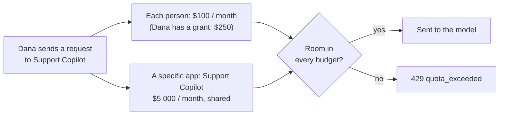

# Budget recipes

Set these up in **Govern > Policy Engine > LLM Gateway > Controls > Budgets & Usage Limits**. Pick a card under **Start from a recipe**, for example **Set a spending budget**. The form has three steps: **Name it and choose who it covers**, **Set the limit** and **Check the budget**, with exceptions, extra windows, alerts and grants under **More options**. **Save to draft**, then **Review & publish**.

 For what each setting means, see [Rate, token and budget limits](./rate-token-and-budget-limits#budgets--usage-limits-card).

| You want | Who it covers |
|---|---|
| The same monthly allowance for everyone | [**Each person**](#per-person) |
| A pool for each team, sized per team | [**Each group gets its own pool**](#group-pool) |
| A per-person allowance that depends on the person's group | [**Each person in a group**, or a group budget set](#per-person-per-group) |
| A cap on one app, and per person inside it | [**A specific app** + **Each person in an app**](#per-app) |
| Per group, per app | [**Each group in an app** and related shapes](#per-group-per-app) |
| A temporary raise or cut for one person | [A grant](#grant) |
| A permanent different limit for one person | [An own limit](#own-limit) |
| The same raise every month | [A scheduled grant](#monthly-top-up) |
| No limit for a service account | [An exemption](#exemption) |



Every matching budget applies, so a request needs room in all of them. The only exception is a group budget set resolved by the strongest group (below). A grant or own limit changes one budget only: another matching budget can still stop the person.

## The same monthly allowance for everyone {#per-person}

**$100 a month for each person, across every app.**

1. Choose **Set a spending budget**. Under **Who**, choose **Each person**.

   

2. Under **Set the limit**, choose **Spend ($)**, enter `100`, and keep **Resets** at **Monthly**.

Requests without a user email are not counted by a per-person budget. To cap them too, add a **Whole organization** budget.

## A pool for each team {#group-pool}

**Sales may spend $2,000 a month in total, Engineering $8,000.**

1. Choose **Set a spending budget**, then **Each group gets its own pool**. Pick **All apps** or the apps, then the Smart groups under **Which groups each get their own pool?** (up to 32).
2. Enter the limit most groups should get. Each group gets its own budget row with that limit. After **Save to draft**, use **Edit** on a group's row to change its amount.
3. Choose what happens for a person in several of these groups:
   - **Their strongest group's budget applies (by rank)**: only the person's best-ranked group's pool is charged.
   - **Every group's budget applies (strictest wins)**: every pool they belong to is charged.


Group order is the **Rank** in the **Groups** section (lower wins). See [Budgets for several groups](./rate-token-and-budget-limits#budgets-for-several-groups).

## A per-person allowance by group {#per-person-per-group}

**Employees $50 each, Engineering $200 each, Executives $500 each, per month.**

- **Same allowance for several groups:** choose **Each person in a group**, choose **All apps** (or pick apps), pick the groups and enter the amount. One budget covers everyone in those groups.
- **Different allowance per group, no overlap:** add one **Each person in a group** budget per group. All of them apply, so someone in both Employees and Executives is stopped by the $50 budget first. Use this when each person is in only one of the groups.
- **Different allowance per group, with overlap:** create a group budget set counted per person with the [Budgets API](../api-reference/budgets-api#group-budget-sets). With `resolve: "strongest"`, an executive who is also in Employees gets $500, provided Executives is ranked ahead of the other groups in **Groups** (the order in `groups` does not matter). The call needs the `budgets:policy` scope and publishes immediately; the console shows the set as **Managed by API**. Use the group names the [Smart groups API](../api-reference/smart-groups-api) returns; virtual groups start with `virtual:`. Add `?dry_run=true` first to see the policy change.

```bash
curl -X POST "$QUILR_BASE/llmgateway/management/v1/budget-sets" \
  -H "Authorization: Bearer $QUILR_MANAGEMENT_KEY" \
  -H "Idempotency-Key: monthly-ai-spend-v1" \
  -H "Content-Type: application/json" \
  -d '{
        "label": "Monthly AI spend",
        "metric": "spend_usd",
        "window": {"kind": "calendar", "unit": "month"},
        "per": ["user.email"],
        "limit": "50",
        "groups": ["Employees", {"group": "Engineering", "limit": "200"}, {"group": "Executives", "limit": "500"}],
        "resolve": "strongest"
      }'
```

## A cap on one app {#per-app}

**Support Copilot may spend $5,000 a month in total, and each person at most $150 of it.**

1. **Set a spending budget**, choose **A specific app**, pick **Support Copilot**, enter `5000`.
2. **Set a spending budget** again, choose **Each person in an app**, pick **Support Copilot**, enter `150`.

Both apply to every Support Copilot request: the pool stops everyone once it is used up, and the per-person budget stops one person earlier. **Each app gets its own** gives every app a separate pool with the same limit.

## Per group, per app {#per-group-per-app}

| Shape | Result |
|---|---|
| **Each group in an app** | One pool for each chosen group, inside the apps you pick. |
| **Each group in each app** | One pool for every chosen group in every app. |
| **A group inside an app** | One pool shared by the chosen groups, in that app. |
| **Each person in a group, inside an app** | A per-person allowance for the chosen groups, in that app. |

## A temporary raise or cut for one person {#grant}

**Dana's limit on the $100 per-person budget should be $250 until 30 November.**

A grant sets a different limit on **one** budget for **one** person (or app) it counts, until a date you choose. It can raise or lower the limit. Grants work on budgets counted **per person** or **per app**. A shared pool, including each group's pool, cannot take grants: change its limit instead.

1. Once per budget: edit it, open **More options**, turn on **Allow grants for this budget**, and enter the **Highest allowed limit** and the **Longest grant** (for example `60d`). The **Allow temporary budget grants** recipe starts a per-person budget with this already on. Publish.

   

2. Open the **Grants** tab, choose the budget and select **New grant**. Under **For**, choose the person, then enter the **Limit**, when it **Ends** (1 day, 7 days, 30 days or a date) and a **Reason**, and select **Grant limit**.

   

The grant shows on the **Grants** tab with **Raised** or **Lowered**, the new and the base limit, and **Change** and **Revoke**.


A grant takes effect right away, without publishing. Usage is not reset: Dana's spend so far still counts toward the $250. When the grant ends, the limit returns to $100. A new grant for the same person on the same budget replaces the current one. A grant above the highest allowed limit or longer than the longest grant is refused.

A grant belongs to one budget. In a per-group budget set, if the person's strongest group changes, a grant on the old group's budget no longer applies to them.

## A permanent different limit for one person {#own-limit}

**The CFO should always have $1,000 a month.**

Use an exception rather than a grant. Edit the budget, open **More options**, select **+ Person** under **Exceptions**, choose **Own limit** and enter the amount. The own limit replaces the budget's limit for that person, shows as its own row, has its own counter starting at zero, and takes effect when you publish.


## The same raise every month {#monthly-top-up}

**Data Science should get $500 instead of $200 every month.**

Grants always end, and do not repeat. Either:

- **Make it permanent.** Give the team its own budget, or give each person an own limit. Nothing to renew.
- **Grant it on a schedule.** The budget must be counted per person, with grants allowed, a highest allowed limit of at least $500 and a longest grant of at least `31d`. On the first of each month, a job grants every member of the Smart group the new limit until the end of the month:

```bash
curl -X POST "$QUILR_BASE/llmgateway/management/v1/budgets/$BUDGET_ID/grants/_bulk" \
  -H "Authorization: Bearer $QUILR_MANAGEMENT_KEY" \
  -H "Idempotency-Key: ds-topup-2026-12" \
  -H "Content-Type: application/json" \
  -d '{
        "subjects_from": {"smart_group": "Data Science"},
        "limit": "500",
        "starts_at": "2026-12-01T00:00:00Z",
        "expires_at": "2026-12-31T23:59:59Z",
        "reason": "Monthly data science allowance"
      }'
```

- The key needs the `budgets:grant` scope. Use a new `Idempotency-Key` each month (and each batch), and reuse it only to retry the same call.
- A grant sets the limit; it does not add to it. Send the full amount.
- One call grants up to 1,000 people; a larger Smart group is refused as a whole. For more people, send batches of up to 1,000 under `grants`, each item just `{"subject": {"user": "..."}}`: the top-level `limit`, dates and `reason` apply to every item.
- Each person succeeds or fails on their own; check `errors` in the response.
- People who join the group later need the next run or a grant of their own.

## No limit for a service account {#exemption}

Use **Exemptions** to exempt a user, app or Smart group from selected budgets, with a reason. A larger overlapping budget does not cancel a smaller one.

## Check the result

- **Usage** shows each person against their effective limit, including any active grant.
- **Test** in the Policy Engine shows which budgets a request would hit before you publish.
- A refused request returns `429 quota_exceeded`. See [When a limit is hit](./rate-token-and-budget-limits#when-a-limit-is-hit).
- One per-person budget covers any number of people, so thousands of employees do not need thousands of budgets. See the Policy Engine [size limits](../../console/govern/policy-engine#size-limits).
