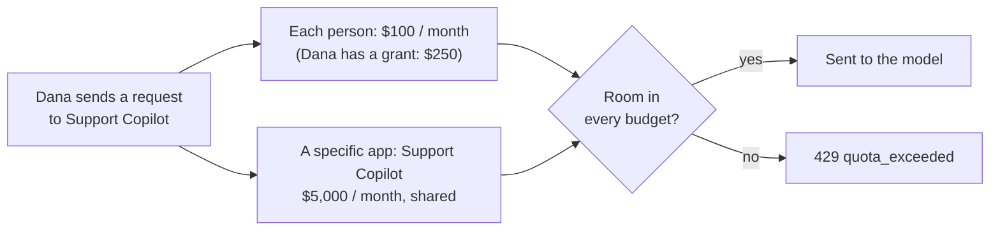
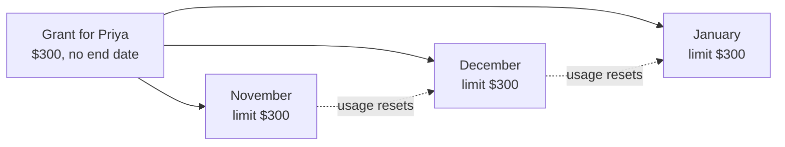
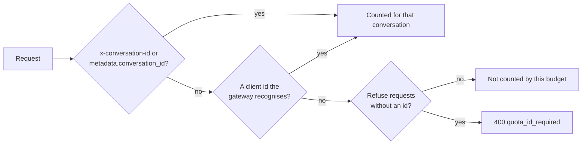

# Budget recipes

Set these up in **Govern > Policy Engine > LLM Gateway > Controls > Budgets & Usage Limits**. Pick a card under **Start from a recipe**, for example **Set a spending budget**. The form has three steps: **Name it and choose who it covers**, **Set the limit** and **Check the budget**, with exceptions, extra windows, alerts and grants under **More options**. **Save to draft**, then **Review & publish**.

 For what each setting means, see [Rate, token and budget limits](./rate-token-and-budget-limits#budgets--usage-limits-card).

| You want | Who it covers |
|---|---|
| The same monthly allowance for everyone | [**Each person**](#per-person) |
| A pool for each team, sized per team | [**Each group gets its own pool**](#group-pool) |
| A per-person allowance that depends on the person's group | [**Each person in a group**, or a group budget set](#per-person-per-group) |
| A cap on one app, and per person inside it | [**A specific app** + **Each person in an app**](#per-app) |
| Per group, per app | [**Each group in an app** and related shapes](#per-group-per-app) |
| A temporary raise or cut for one person | [A grant](#grant) |
| A raise for everyone in a group, including people who join later | [A Smart group grant](#group-grant) |
| A different monthly allowance for a person or team, every month | [A grant with no end date](#monthly-allowance) |
| A permanent different limit for one person, in the policy | [An own limit](#own-limit) |
| A set amount more than the budget, even if the budget changes | [An extra grant](#raise-by-amount) |
| Give heavy users a little more, automatically | [Automatic raises](#automatic-raises) |
| Stop a runaway chat or agent | [A conversation or agent cap](#conversation-agent-caps) |
| Know who will run out before they do | [Forecasts and grants ending soon](#running-out) |
| Move to a cheaper model as a budget runs low | [Route by budget used](#route-by-budget-used) |
| No limit for a service account | [An exemption](#exemption) |



Every matching budget applies, so a request needs room in all of them. The only exception is a group budget set resolved by the strongest group (below). A grant or own limit changes one budget only: another matching budget can still stop the person.

## The same monthly allowance for everyone {#per-person}

**$100 a month for each person, across every app.**

1. Choose **Set a spending budget**. Under **Who**, choose **Each person**.

   

2. Under **Set the limit**, choose **Spend ($)**, enter `100`, and keep **Resets** at **Monthly**.

Requests without a user email are not counted by a per-person budget. To cap them too, add a **Whole organization** budget.

## A pool for each team {#group-pool}

**Sales may spend $2,000 a month in total, Engineering $8,000.**

1. Choose **Set a spending budget**, then **Each group gets its own pool**. Pick **All apps** or the apps, then the Smart groups under **Which groups each get their own pool?** (up to 32).
2. Enter the limit most groups should get. Each group gets its own budget row with that limit. After **Save to draft**, use **Edit** on a group's row to change its amount.
3. Choose what happens for a person in several of these groups:
   - **Their strongest group's budget applies (by rank)**: only the person's best-ranked group's pool is charged.
   - **Every group's budget applies (strictest wins)**: every pool they belong to is charged.


Group order is the **Rank** in the **Groups** section (lower wins). See [Budgets for several groups](./rate-token-and-budget-limits#budgets-for-several-groups).

## A per-person allowance by group {#per-person-per-group}

**Employees $50 each, Engineering $200 each, Executives $500 each, per month.**

- **Same allowance for several groups:** choose **Each person in a group**, choose **All apps** (or pick apps), pick the groups and enter the amount. One budget covers everyone in those groups.
- **Different allowance per group, no overlap:** add one **Each person in a group** budget per group. All of them apply, so someone in both Employees and Executives is stopped by the $50 budget first. Use this when each person is in only one of the groups.
- **Different allowance per group, with overlap:** create a group budget set counted per person with the [Budgets API](../api-reference/budgets-api#group-budget-sets). With `resolve: "strongest"`, an executive who is also in Employees gets $500, provided Executives is ranked ahead of the other groups in **Groups** (the order in `groups` does not matter). The call needs the `budgets:policy` scope and publishes immediately; the console shows the set as **Managed by API**. Use the group names the [Smart groups API](../api-reference/smart-groups-api) returns; virtual groups start with `virtual:`. Add `?dry_run=true` first to see the policy change.

```bash
curl -X POST "$QUILR_BASE/llmgateway/management/v1/budget-sets" \
  -H "Authorization: Bearer $QUILR_MANAGEMENT_KEY" \
  -H "Idempotency-Key: monthly-ai-spend-v1" \
  -H "Content-Type: application/json" \
  -d '{
        "label": "Monthly AI spend",
        "metric": "spend_usd",
        "window": {"kind": "calendar", "unit": "month"},
        "per": ["user.email"],
        "limit": "50",
        "groups": ["Employees", {"group": "Engineering", "limit": "200"}, {"group": "Executives", "limit": "500"}],
        "resolve": "strongest"
      }'
```

## A cap on one app {#per-app}

**Support Copilot may spend $5,000 a month in total, and each person at most $150 of it.**

1. **Set a spending budget**, choose **A specific app**, pick **Support Copilot**, enter `5000`.
2. **Set a spending budget** again, choose **Each person in an app**, pick **Support Copilot**, enter `150`.

Both apply to every Support Copilot request: the pool stops everyone once it is used up, and the per-person budget stops one person earlier. **Each app gets its own** gives every app a separate pool with the same limit.

## Per group, per app {#per-group-per-app}

| Shape | Result |
|---|---|
| **Each group in an app** | One pool for each chosen group, inside the apps you pick. |
| **Each group in each app** | One pool for every chosen group in every app. |
| **A group inside an app** | One pool shared by the chosen groups, in that app. |
| **Each person in a group, inside an app** | A per-person allowance for the chosen groups, in that app. |

## A temporary raise or cut for one person {#grant}

**Dana's limit on the $100 per-person budget should be $250 until 30 November.**

A grant sets a different limit on **one** budget for **one** person (or app) it counts, until a date you choose. It can raise or lower the limit. Grants work on budgets counted **per person** or **per app**. A shared pool, including each group's pool, cannot take grants: change its limit instead.

1. Once per budget: edit it, open **More options**, turn on **Allow grants for this budget**, and enter the **Highest allowed limit** and the **Longest grant** (for example `60d`). Tick **No end date allowed** if grants may run until you revoke them. The **Allow temporary budget grants** recipe starts a per-person budget with this already on. Publish.

   

2. Open the **Grants** tab, choose the budget and select **New grant**. Under **For**, choose **A person** (or **Members of a smart group**, [below](#group-grant)), then enter the **Limit**, when it **Ends** (a preset, a date, or no end date where the budget allows it) and a **Reason**, and select **Grant limit**.

   

The grant shows on the **Grants** tab with **Raised** or **Lowered**, the new and the base limit, what the person has used so far, and **Change** and **Revoke**. **Ending soonest** and **Ending in 7 days** sort and filter the list, so grants that are about to lapse are easy to extend.


A grant takes effect right away, without publishing, unless it has a later start: then it shows as **scheduled** until that time (`status: scheduled` in the API, where `status=active` lists only grants in effect now). Usage is not reset: Dana's spend so far still counts toward the $250. When the grant ends, a Smart group grant that covers Dana takes over if there is one; otherwise the limit returns to $100. A new grant for the same person on the same budget replaces the current one. A grant above the highest allowed limit or longer than the longest grant is refused.

A grant belongs to one budget. In a per-group budget set, if the person's strongest group changes, a grant on the old group's budget no longer applies to them. Deleting a budget (or a rate limit) revokes its active and scheduled grants, so a budget created later with the same ID starts without them.

## A raise for a whole group {#group-grant}

**Everyone in Data Science gets $500 instead of $200 this quarter, including people who join during it.**

On a budget counted **per person** with grants allowed, choose **New grant**, then **Members of a smart group**, pick the group, and enter the limit, end and reason.


- The grant follows the group: people who join get it on their next request, people who leave lose it. There is nothing to re-run.
- It can raise or lower the limit, within the highest allowed limit and the longest grant.
- **Which grant applies:** a person's own grant wins over a group grant. A person in several groups with grants gets the grant of their best-ranked group (the **Rank** in **Groups**, the same order group budget sets use). Otherwise the budget limit applies.
- Revoking a person's own grant leaves them on the group grant, if one covers them. Revoking a group grant leaves people's own grants in place.

**Who is counted** shows where each person's limit comes from (`Grant ... via <group>`), with **Give their own grant** and **Change the group grant** on each row.


On the **Grants** tab, each group grant shows how many members it covers, how many have their own grant or another group's, and how many are at the limit. **View N members** lists every member, including those who have not used the budget yet. In the API: `GET /budgets/{id}/usage?members_of=<group>` (each row has `limit_source`), and `members` on group grants.


Group grants work only on budgets counted per person.

## A permanent different limit for one person {#own-limit}

**The CFO should always have $1,000 a month.**

Use an exception rather than a grant. Edit the budget, open **More options**, select **+ Person** under **Exceptions**, choose **Own limit** and enter the amount. The own limit replaces the budget's limit for that person, shows as its own row, has its own counter starting at zero, and takes effect when you publish.


## A monthly allowance for a person or team {#monthly-allowance}

**Priya should always get $300 a month instead of $100, and everyone in Data Science $500.**

A grant with no end date on a monthly budget is a permanent limit for that person. The budget still resets every month, and the grant's limit applies to each new month until you revoke it. There is no separate "recurring grant": this is it.



1. Once per budget: under **Allow grants for this budget**, tick **No end date allowed** (`adjustments.max_duration: "unlimited"` in the API) and set a **Highest allowed limit** at least as high as the largest allowance. Publish.
2. On the **Grants** tab, select **New grant**:
   - **For one person:** choose **A person**, enter the limit and choose no end date.
   - **For a team:** choose **Members of a smart group** and pick the group. The grant follows membership: people who join get it, people who leave lose it. A person's own grant still wins over the group's.

With the API, leave out `expires_at`:

```bash
curl -X POST "$QUILR_BASE/llmgateway/management/v1/budgets/$BUDGET_ID/grants" \
  -H "Authorization: Bearer $QUILR_MANAGEMENT_KEY" \
  -H "Idempotency-Key: ds-monthly-allowance" \
  -H "Content-Type: application/json" \
  -d '{"subject": {"members_of": "Data Science"}, "limit": "500", "reason": "Data Science monthly allowance"}'
```

The grant reads back with `no_end_date: true`. To change the allowance, change the grant; to end it, revoke it.

### A different amount for one month only {#monthly-top-up}

To give a group more for a single month, grant it with a start and an end. The budget must allow grants with a **Longest grant** of at least `31d`. You can create it before the month starts: it shows as **scheduled** until `starts_at`, and the grant in effect keeps applying until its own end or the new grant's start, whichever comes first.

```bash
curl -X POST "$QUILR_BASE/llmgateway/management/v1/budgets/$BUDGET_ID/grants/_bulk" \
  -H "Authorization: Bearer $QUILR_MANAGEMENT_KEY" \
  -H "Idempotency-Key: ds-topup-2026-12" \
  -H "Content-Type: application/json" \
  -d '{
        "subjects_from": {"smart_group": "Data Science"},
        "extra": "300",
        "starts_at": "2026-12-01T00:00:00Z",
        "expires_at": "2026-12-31T23:59:59Z",
        "reason": "December launch"
      }'
```

- The key needs the `budgets:grant` scope. Use a new `Idempotency-Key` for each call, and reuse it only to retry the same call.
- `subjects_from` gives each current member their own grant (up to 1,000 people; a larger group is refused as a whole). For more people, send batches of up to 1,000 under `grants`, each item just `{"subject": {"user": "..."}}`: the top-level amount, dates and `reason` apply to every item. People who join later are not covered; a `members_of` grant covers them.
- Each person succeeds or fails on their own; check `errors` in the response.

## Raise by an amount {#raise-by-amount}

**Dana should get $50 more than the per-person budget this month.**

A grant takes exactly one of two amounts (in the API):

| Field | Meaning | Budget limit later changes from $100 to $120 |
|---|---|---|
| `limit` | The person's limit, absolute. | Dana stays at the granted limit. |
| `extra` | Added on top of the budget's limit. | Dana's limit follows: $150, then $170. |

```bash
curl -X POST "$QUILR_BASE/llmgateway/management/v1/budgets/$BUDGET_ID/grants" \
  -H "Authorization: Bearer $QUILR_MANAGEMENT_KEY" \
  -H "Idempotency-Key: dana-extra-2026-11" \
  -H "Content-Type: application/json" \
  -d '{"subject": {"user": "dana@example.com"}, "extra": "50", "expires_at": "2026-11-30T23:59:59Z", "reason": "Launch week"}'
```

- The budget's **Highest allowed limit** still caps the result. A grant whose budget limit plus `extra` is above it is refused (`422 grant_above_ceiling`); if the budget limit rises later, the limit stops at the highest allowed limit.
- Reads show the resulting `limit` and the `extra` amount.
- Changing a grant with `limit` makes it absolute; changing it with `extra` makes it follow the budget again.
- Bulk grants take a top-level `limit` or `extra`, and each item may override it with its own.

## Raise limits automatically {#automatic-raises}

**When someone hits their $100 monthly limit, give them 25% more, at most twice a month, never above $200.**

Edit the budget, open **More options**, turn on **Allow grants for this budget**, set the **Highest allowed limit**, then tick **Raise the limit automatically**:


- **+ % of the limit each time**: each raise adds this share of the budget limit, never above the highest allowed limit.
- **Up to N times per period**: the most raises one person gets in a reset period.
- **When**: **At the limit** tries a raise when a request would be refused; the request goes through if the raise succeeds and every other matching budget has room. **At a share used** checks recorded usage after requests and raises once someone is at or past the share you enter.
- **Only for these smart groups**: leave empty for everyone the budget counts.

Raises are off until you turn them on. Each raise is a grant marked **Automatic** on the **Grants** tab and ends when the budget resets, or sooner if the **Longest grant** is shorter. Turning raises off stops new ones; raises already made stay until they end or you revoke them. Revoking an automatic raise also stops further raises for that person until the next reset. A person whose limit an admin lowered is never raised. Automatic raises work on budgets that reset every day, week or month; a one-time allowance or a rolling window has no reset for them to end at.

Without automatic raises, an enforced budget refuses the request once it is used up (`429 quota_exceeded`).

## Cap a conversation or an agent {#conversation-agent-caps}

**A $20 allowance for each conversation, and $50 a day for each agent.**

Use the **Cap each conversation**, **Daily cap per agent** or **Cap each agent run** recipe, or pick **Each conversation**, **Each agent** or **Each agent run** under **Who**.


Conversations and agent runs end, so these start as a **One-time allowance (never resets)**; change **Resets** if you want a period instead.


With the API, a per-conversation cap is a `lifetime` window. A lifetime budget never resets, so a new one must also send `"one_time": true` to confirm it (`422 lifetime_requires_one_time` otherwise). `"missing_id": "refuse"` refuses requests that carry no conversation id:

```bash
curl -X POST "$QUILR_BASE/llmgateway/management/v1/budgets" \
  -H "Authorization: Bearer $QUILR_MANAGEMENT_KEY" \
  -H "Idempotency-Key: conversation-cap-v1" \
  -H "Content-Type: application/json" \
  -d '{
        "id": "conversation_cap",
        "label": "No conversation over 20 USD",
        "metric": "spend_usd",
        "limit": "20",
        "per": ["user", "conversation"],
        "window": {"kind": "lifetime"},
        "one_time": true,
        "missing_id": "refuse"
      }'
```

An id you send always wins:

| Who | Request header | Or in the body |
|---|---|---|
| Each conversation | `x-conversation-id` | `metadata.conversation_id` |
| Each agent | `x-quilr-agent-id` | `metadata.agent_id` |
| Each agent run | `x-quilr-agent-run-id` | `metadata.agent_run_id` |

Without one, the gateway uses the id the client already sends, so most coding tools and agent platforms need no change:

| Who | Ids the gateway recognises, first match wins |
|---|---|
| Each conversation | Responses API `conversation`, Claude Code session, Microsoft Copilot Studio conversation, Codex and OpenCode sessions, body `metadata.session_id`, OpenClaw sessions, `x-session-id`, `session-id`, `thread-id`, `x-agent-thread-id`, Helicone, Cloudflare AI Gateway and TrueFoundry session ids |
| Each agent | `x-agent-id`, Claude Code subagent, Copilot Studio agent, OpenClaw scheduled job |
| Each agent run | `x-agent-run-id`, Codex parent thread, `x-agent-task-id`, `x-task-id`, `agent-session-id` |



- A coding tool's session can last many hours, so for those tools a conversation cap works as a cap per tool session.
- A request without any id is not counted by that budget. To refuse it instead, tick **Refuse requests that have no conversation id** (or agent id, agent run id) under **Who**, or **Missing id** when editing: the gateway answers `400 quota_id_required` and lists the ids it accepts. Ids are 1 to 256 characters.
- Spend is counted when a request completes, so requests already in flight can take a conversation past its allowance before the next one is refused.
- A conversation cap is counted per person too, so two people reusing an id do not share a counter.
- Ids come from the caller, so a cap is a guard against runaway loops, not a security boundary: keep a per-person or per-app budget alongside it.
- The `x-quilr-*` headers are removed before the request reaches the model provider.


## See who will run out {#running-out}

For budgets that reset every day, week or month, the gateway projects each person's spend to the reset from their recent rate.

- **Usage** shows **Runs out** with a time next to anyone on pace to hit their limit before the reset, and **Running out soon** lists everyone at the limit or due to reach it within 7 days.
- The **Grants** tab's **Ending in 7 days** lists grants about to end.
- From scripts: `GET /budget-forecast` lists everyone at or near their limit across budgets, `GET /budgets/{id}/burn-rate` gives one budget's rates and projections, and `GET /budget-grants?ends_within=7d` lists grants ending soon. See the [Budgets API](../api-reference/budgets-api#forecasts-and-grant-views).

## Move to a cheaper model as a budget runs low {#route-by-budget-used}

**Once someone has used 80% of their monthly budget, send their chat requests to a smaller model.**

A routing rule can read how much of a budget the requester has used, with grants included. In a policy, replacing `monthly_ai_spend` with your budget's ID and the target with one of your models:

```text
policy cheaper_after_80 priority 700 {
  request where budget_used_pct("monthly_ai_spend") >= 80
  then {
    routing.targets = [{ model: "gpt-4.1-mini", provider_label: "openai_primary" }];
    routing.route_decision = per_message;
  }
}
```

Or add a budget condition to a route with the [Routing and failover API](../api-reference/routing-and-failover-api).

- Route below 100%: an enforced budget that is used up still refuses the request if it applies to the chosen model, unless an automatic raise succeeds.
- Use a budget counted per person, app or group. A budget counted per model or provider has no value before the model is chosen, so the rule never matches.
- If the usage cannot be read in time, or the requester is not counted by that budget, the rule does not match and normal routing applies.
- The value is the requester's usage of that budget even when the budget's own scope does not cover this request; add an app condition to the rule if needed.

## No limit for a service account {#exemption}

Use **Exemptions** to exempt a user, app or Smart group from selected budgets, with a reason. A larger overlapping budget does not cancel a smaller one.

## Check the result

- **Usage** shows each person against their effective limit, including any active grant.
- **Test** in the Policy Engine shows which budgets a request would hit before you publish.
- A refused request returns `429 quota_exceeded`. See [When a limit is hit](./rate-token-and-budget-limits#when-a-limit-is-hit).
- One per-person budget covers any number of people, so thousands of employees do not need thousands of budgets. See the Policy Engine [size limits](../../console/govern/policy-engine#size-limits).
