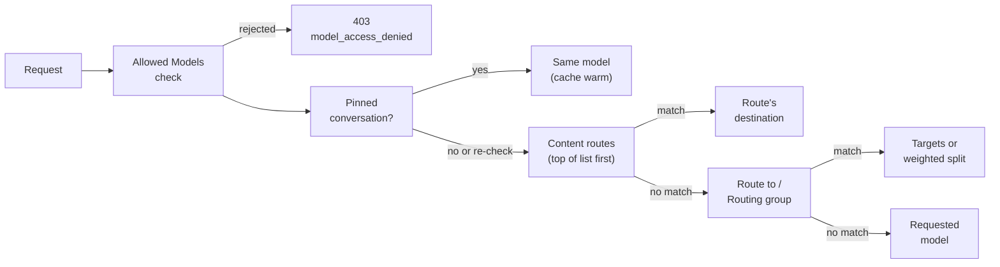
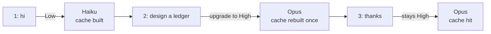

# Policy Engine routing

With the Policy Engine on for the LLM Gateway, the **Model routing** card decides which provider and model serve each conversation. You can send an app to a fixed model, split traffic by weight, or pick the model from what the conversation contains: its topic, the data in it, how hard the prompt is, a phrase, or the coding tool that sent it.

This page covers the card. For routing groups and failover set on an app without the Policy Engine, see [Routing and fallbacks](./routing-and-fallbacks).

## Where it lives

<ConsolePath
  console="QuilrAI console"
  href="https://web.quilr.ai"
  path={['Govern', 'Policy Engine', 'LLM Gateway', 'Routing & cost']}
  action="Model routing"
/>


The card opens a drawer with three tabs:

| Tab | What it shows |
|---|---|
| **Overview** | Per section, what applies to **Everyone** and each scoped configuration with its priority (for example `P783`). |
| **Controls** | **Quick add**, then each section with its configurations: **Conversations**, **Content routes**, **Route to**, **Routing groups**, **Complexity levels**, and **Routing activity** at the bottom. |
| **Activity** | Requests where the card's settings applied in the last 7 days: how many were routed by a policy, which rules matched and which settings decided. |

Every form adds to one shared draft. Nothing changes for live traffic until you **Review & publish**.

## How a request is routed



- **Content routes** are checked in list order. Higher in the list wins. A complexity setup counts as one route.
- **Route to** and **Routing groups** decide only when no content route matches.
- **Rejected models** on the [Allowed Models card](../protect/gateway-access-and-allowed-models) win over every route, including models reached through routing.
- When two configurations set the same thing, the more specific scope wins: a person over a group, a group over an app, an app over everyone.

## Quick add

The fastest way to start is **Controls > Quick add**. Pick what you want, then who it is for (**Everyone**, **For specific apps** or **For specific groups**). It opens a filled-in form; nothing changes until you publish.


| Quick add | Creates | Section |
|---|---|---|
| **Send an app to a model** | An ordered list of provider and model targets. | Route to |
| **Split traffic across models** | A weighted split. | Routing groups |
| **Route by what the request is about** | A route that AI matches against a sentence you write. | Content routes |
| **Route sensitive data to a model** | A route that fires when chosen data types appear. | Content routes |
| **More... > Small model for simple prompts, big model for hard ones** | Two-level complexity routing. | Content routes |
| **More... > Three tiers: small / medium / large** | Low, Medium and High complexity routing. | Content routes |
| **More... > By message length only (no AI)** | Complexity by word or token count, no AI check. | Content routes |
| **More... > Split hard prompts across models** | Complexity routing where High is a weighted split. | Content routes |


## Routing types at a glance

| Type | Decides by | Uses AI | Default conversation behaviour |
|---|---|---|---|
| [Route to](#route-to) | Scope only (app, group, requested model, ...) | No | Keep destination |
| [Routing groups](#routing-groups) | Weights across models | No | Keep destination (each new conversation is assigned once) |
| [Request is about](#request-is-about-description-routing) | A sentence describing the requests | Yes | Keep destination |
| [Prompt complexity](#complexity-routing) | Low, Medium or High level | Yes, or length only | Upgrade when needed |
| [Data detected](#data-detected) | Data types found in the latest message | Data scan | Checked on every message |
| [Text contains](#text-contains) | Words or phrases | No | Keep destination |
| [Client](#client) | The coding tool named in request headers | No | Keep destination |

All of them apply on the `bedrock`, `chat`, `responses` and `vertex` API surfaces. Routing groups also apply on `realtime`.

## Route to

An ordered fallback list of provider credential and model pairs. The first target with an enabled credential serves the conversation, whatever model the client asked for. Use it to pin an app to a model, or to keep a backup when a credential is disabled.

1. **Quick add > Send an app to a model**, then pick the apps or groups.
2. Under **Send to**, keep **Ordered targets**. Pick a **Provider label** and a **Model** for target 1.
3. **Add target** for each fallback. Drag the handle, or use the arrow keys on it, to reorder.
4. **Add to draft**, then **Review & publish**.

:::note
Targets are skipped only when their credential is disabled or unavailable. An upstream error on target 1 is not retried on target 2.
:::

```text
policy support_copilot_route priority 650 {
  request where application.group_key == "support-copilot"
  then { routing.targets = [
    { model: "gpt-4.1", provider_label: "openai_primary" },
    { model: "gpt-4.1", provider_label: "azureopenai_primary" }
  ]; }
}
```

## Routing groups

A weighted split across models. Weights always total 100.

1. **Quick add > Split traffic across models**, then pick who it is for.
2. Under **Split**, give it a **Name**, then choose **Kind** (Chat completion, Anthropic messages, Responses, Vertex AI, Bedrock or Realtime) and **Mode**:
   - **New conversations**: weights split new conversations.
   - **Split by tokens**: weights split total tokens.
3. **Add model** for each model and set its weight. **Balance evenly** splits them equally.


Weights split new conversations, not requests: a conversation stays on the model it started with. Request and spend shares can therefore differ from the percentages. The group name is saved as `policy-<name>` and applies only within the policy, so it never affects an app routing group with the same name.

## Content routes

Content routes send a conversation to a model based on what it contains. They all use one form, **Add a content route**: choose who it applies to, what to look for under **Match when**, then where it goes under **Send to** (**Ordered targets** or **Routing group**).

### Request is about (description routing)

Describe the requests in a sentence or two. AI judges whether the latest user message is about that description.

1. **Quick add > Route by what the request is about**, then pick who it is for.
2. Under **Describe these requests in a sentence or two**, write what the requests look like, for example `Programming help: source code, SQL queries, shell scripts, bugs or stack traces.`
3. Under **Send to**, pick the model.


- AI reads up to the message's last 32 KB, then the first and last ~500 tokens of that.
- Up to 32 descriptions are checked per request, highest priority first. Keep the most important routes at the top.
- Descriptions are limited to 300 characters.
- If AI matching is unavailable or times out, the route is skipped and **Routing activity** shows why. The request falls through to the next route, then to **Route to**, **Routing groups** or the requested model.

```text
policy route_coding priority 720 {
  request where application.method_type == "chat"
    and about(content.last_user_text, "Programming help: source code, SQL queries, shell scripts, bugs or stack traces.")
  then { routing.targets = [{ model: "claude-sonnet-4-6", provider_label: "anthropic_primary" }]; }
}
```

### Complexity routing

Send simple prompts to a small model and hard ones to a large model. Start from a complexity quick add card or **Set up complexity routing** under **Complexity levels**.


1. **Application**: pick the app, or leave empty for every app.
2. **When the app asks for** (optional): limit the setup to requested model names, for example `auto`. Leave empty for every model.
3. **How to judge**:
   - **AI reads the message (falls back to length)**: AI compares the latest user message with your level descriptions. If the AI check is unavailable or unsure, the length bounds decide.
   - **Message length only**: words or tokens in the latest user message decide. No AI check and no extra cost.
4. **Levels**: for **Low** (and **Medium** with **Use a Medium level**), write what the level means and its upper bound in **Words** or **Tokens** (about 0.75 words per token). **High** is anything longer or harder.
5. For each level, choose where it goes: **Normal routing** (keep its usual destination), **One model or first available**, or **Split by %**.
6. **Switching**: how a conversation moves between levels. See [Conversations and caching](#conversations-and-caching).

| Level | Default description | Default bound |
|---|---|---|
| Low | Short factual questions, greetings, or one-step rewrites of a few sentences. | 300 tokens |
| Medium | Everyday drafting, summarising or analysing a short document or snippet. | 4,000 tokens |
| High | Multi-step reasoning, planning, large codebases or long documents. | Anything above Medium |

Without any levels, Prompt complexity uses word counts: 6 words or fewer is Low, 7 to 10 is Medium, longer is High.

:::tip
Use **Message length only** when you want routing that is predictable and free. Use AI judging when short prompts can still be hard ("prove this lemma"); the length bounds still act as the fallback.
:::

The form saves one levels policy plus one route per level:

```text
policy cx priority 760 {
  request where application.group_key == "support-copilot"
  then { routing.complexity_levels = {
    low:    { description: "Greetings and short factual questions", max_tokens: 300 },
    medium: { description: "Everyday drafting and summaries", max_tokens: 4000 },
    high:   { description: "Multi-step reasoning, design or long analysis" }
  }; }
}
policy cx_low priority 759 {
  request where application.group_key == "support-copilot" and content.context_complexity == "low"
  then { routing.targets = [{ model: "claude-haiku-4-5-20251001", provider_label: "anthropic_primary" }];
         routing.route_decision = escalate; }
}
// cx_medium and cx_high follow the same shape
```

For length only, the levels value is `{ method: length, low: { max_words: 15 }, medium: { max_words: 120 }, high: {} }`.

A single **Prompt complexity** content route (Low, Medium or High checkboxes) uses the levels defined under **Complexity levels** on the card.


### Data detected

Move a conversation to a model you trust when chosen data types appear, for example on-premises models for secrets.

1. **Quick add > Route sensitive data to a model**.
2. Under **Any of these is detected**, choose the data types.
3. Pick the destination.

- Data routes are checked on every message and are placed first by default. A route above a data route can win for the same request, so keep data routes at the top.
- Once matched, the conversation keeps this destination from then on.
- It is best effort: the latest user message is checked, and if the check cannot run, normal routing is used. Routing on data does not guarantee sensitive content stays private; use [Security guardrails](../protect/security-guardrails) to redact or block.
- Types used only for routing do not create findings, redact or block. Matches appear in **Routing activity**.

### Text contains

Route when the latest user message contains any of a list of words or phrases. Comma separated and not case-sensitive. Use `*` for any text in between (`refund*order`) and `?` for one character.

### Client

Route by the coding tool or client named in the request headers, for example Claude Code, Codex, Cursor, Cline or GitHub Copilot. This is reported by the client and is not an identity check.

### Observe only

Every content route has an **Observe only** switch. The route is checked on every message and **Routing activity** records where matching conversations would go, while requests keep their normal destination. Use it to size a route before turning it on. AI and data checks still run, so they still add latency.

### Order

Under **Order**, choose where a route sits in the list (**1st**, **after** another route, or **Last**). Higher in the list wins. New routes go last; data routes go first. On the card, **Earlier** and **Later** move a route.

## Conversations and caching

Providers cache the start of a prompt (system prompt, tools, earlier turns) so the next request in the same conversation is cheaper and faster. The cache belongs to one provider and model. Every time a conversation moves to another model, the new model starts with a cold cache. Routing is therefore built around conversations, not single requests.

### Conversation pinning

A conversation stays on the model and provider it started with, by default until it has been idle for 1 hour, so answers stay consistent and prompt caches hit more often. Each requested model is pinned separately, so a coding tool's helper model can route on its own.

The gateway recognises a conversation by, in order:

1. The conversation ID header (`x-conversation-id`, `conversation-id` or `conversation_id`).
2. The coding tool's session ID.
3. Otherwise, the user, system prompt and first message.

Send a conversation ID header when you can. The Identity & Network Trust card can [require one](../protect/identity-and-network-trust).

A pinned conversation is routed again when:

- the rule that chose its destination is edited, removed or expires,
- the destination becomes unavailable,
- 3 upstream errors happen in a row,
- or a data route matches.

### Conversation behaviour

Each content route has a **Conversation behaviour** (called **Switching** in the complexity form):

| Option | What happens | Cache effect |
|---|---|---|
| **Keep destination** (default for most routes) | The first message decides; later messages stay there. A higher route can still take over. | Best: one model for the whole conversation. |
| **Upgrade when needed** (default for complexity) | Each message is checked; the conversation moves up a level when needed, never back down. | One cache rebuild per upgrade. "hi" > Low; hard question > High; "thanks" > stays High. |
| **Re-check every message** | Each message routes on its own. With AI judging, that is an AI check per message. | Can switch model on any message, losing the cache each time. |



How caching behaves per routing type:

| Scenario | What happens to the provider cache |
|---|---|
| Route to, Text contains, Client, Request is about (Keep destination) | Conversation stays on one model; cache stays warm. |
| Routing group | Each conversation is assigned one model in the split and stays there, so caches stay warm. |
| Complexity with Upgrade when needed | At most one move per level change; each upgrade costs one cache rebuild. |
| Any route with Re-check every message | A change of model on any message starts a new cache. |
| Data detected | A data match moves the conversation and starts a new cache there. |
| Observe only | Nothing moves; the cache is unaffected. |

### Keep prompt cache warm

Provider caches expire after a few minutes without traffic. **Conversations > Set up** opens **Keep prompt cache warm** for chosen apps:


| Setting | What it does |
|---|---|
| **Longer cache on Anthropic and Bedrock Claude** | Asks Anthropic and Bedrock Claude 4.5+ to keep the prompt cache for 1 hour instead of 5 minutes. No extra requests; cache writes cost about 2x base input instead of 1.25x. |
| **Refresh requests on OpenAI, Azure, Gemini and Vertex** | Sends a small paid request shortly before the cache expires (OpenAI, Azure OpenAI, OpenAI-compatible, Gemini, Vertex and Responses). Each resends the prompt for 1 output token (16 on Responses), billed to the app and counted toward its quotas and spend. Refreshes stop on a quota refusal or after 2 upstream errors. |
| **Stop refreshes after idle (minutes)** | 1 to 60, default 30. |
| **Minimum prompt (tokens)** | Smaller prompts are not kept warm. Default 4,000. |

Never kept warm: requests using server-side tools or web search, Responses conversation or background state, private inference, blocked or cache-hit requests, and prompts below the minimum. Keep warm applies to conversations that stay on one model.

```text
routing.keep_cache_warm = { stop_after_idle_minutes: 30, min_prompt_tokens: 4000, extend_cache_lifetime: true, refresh_requests: true };
```

:::note
The **Response cache** on the [Token Savings](./token-saving) card is different: it answers an exact repeat of a non-streaming request from an earlier response, without calling the model or running guardrails. Keep prompt cache warm only keeps the provider's prompt cache alive.
:::

## Test and verify

### Test before you publish

The content route and complexity forms have a **Test** row that runs against the whole draft, all routes included. Pick the **App**, write a **Sample first message**, optionally **Add a follow-up message** (up to 5), **Test as user (email)** or **Test as client**, then **Run test**. Routing checks run; no model is called.


The result shows, per message, the level, which route matched and where it would go, and each route's outcome: **Matched**, **No match**, **Not evaluated**, **Unavailable** or **Timed out**.

### Check live traffic

Every gateway response carries two headers:

| Header | Value |
|---|---|
| `x-quilr-route` | `default` when no route applied, otherwise the route id (`r_` and 16 hex characters). |
| `x-quilr-served-model` | The model that served the request. |

```bash
curl -sD - -o /dev/null https://guardrails-usa-2.quilr.ai/openai_compatible/v1/chat/completions \
  -H "Authorization: Bearer sk-quilr-xxx" -H "Content-Type: application/json" \
  -d '{"model": "gpt-4.1-nano", "messages": [{"role": "user", "content": "hi"}]}' | grep -i x-quilr
```

**Routing activity**, at the bottom of the Controls tab, shows what each published route did per app over 24 h, 7 d or 30 d: conversations, requests, spend (including keep-warm refreshes), cache read, added time, failures, upgrades and fallbacks. Hover a route to see its route id.


## Rules and limits

- The requested model must be allowed for the app. A name such as `auto` that only exists for routing is rejected with `model_access_denied` before routing runs unless the app's allowed models include it.
- A destination must support the request's API. When it cannot (for example an OpenAI model for an Anthropic Messages request), those requests use normal routing and the editor warns before you publish.
- Two overlapping routing rules cannot share a priority.
- **Upgrade when needed** is only for complexity routes. **Observe only** cannot be combined with a conversation behaviour.
- **Request is about** cannot be negated, and its route can only set a destination.

## Related

- [Routing and fallbacks](./routing-and-fallbacks) - app routing groups, custom routing and failover
- [Gateway access and allowed models](../protect/gateway-access-and-allowed-models)
- [Token saving](./token-saving) - response cache and prompt compression
- [Author, simulate and publish](../../console/govern/author-simulate-and-publish)
- [Policy Engine overview](../../console/govern/policy-engine)
