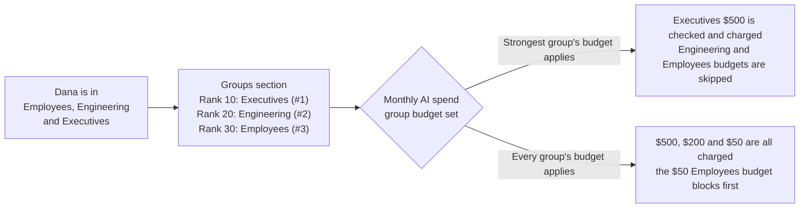

import Tabs from '@theme/Tabs';
import TabItem from '@theme/TabItem';

# Rate, token and budget limits

Updated on 7 November 2026.

Cap how long calls run, how many run at once, how many requests an app makes and how many tokens or dollars it spends. The gateway enforces the limits; request counts are checked at admission, while tokens and spend are accounted as requests complete.

## Configure this control

Choose the mode used by your gateway. When the Policy Engine is on, published rules govern this control; classic values saved through **Edit anyway** apply only after the engine is disabled. See [What happens to classic settings](../../console/govern/switching-from-classic-settings#what-happens-to-classic-settings).

<Tabs groupId="gateway-configuration-mode" defaultValue="policy">
<TabItem value="classic" label="Classic settings">

## Turn it on for an app {#turn-it-on-for-an-app}

Open the app from **Settings > AI Gateway > LLM Gateway** and choose any **Configure** option to open the app workspace's **Settings** tab, then select **Rate and Token Limits** under **Protection**. New apps have no limits set. Leave a field empty to keep it unlimited.

| Group | Setting | What it limits |
|-------|---------|----------------|
| Request limits | **Timeout (seconds)** | How long one call may run before the gateway ends it. |
| Request limits | **Concurrency per minute** | Calls in flight for the whole app, per minute. |
| Application rate limit | **Requests** per **Minute / Hour / Day** | Requests the app may make in a rolling window. Turn on **Enabled** to apply it. |
| Token limits | **Max tokens per request** | Tokens in a single request. |
| Token limits | **Input token limit** per Minute / Hour / Day | Input tokens in a rolling window. |
| Token limits | **Output token limit** per Minute / Hour / Day | Output tokens in a rolling window. |
| Per-model limits | Any of the above for one provider's model | Overrides the app limits for that model. Models without an override use the app limits. |

App limits apply to the whole app, across all of its Quilr keys. Classic app settings have no USD budget and no per-person limit; both need the Policy Engine.

</TabItem>
<TabItem value="policy" label="Policy Engine">

## Going further with the Policy Engine {#going-further-with-the-policy-engine}

Open **Govern > Policy Engine > LLM Gateway > Controls > Budgets & Usage Limits**. This one panel owns budgets, rate limits and request guards; there is no separate Rate, Token & Timeout Limits control on the overview.

Start from a recipe or use **Custom**, choose the scope and the limit, then **Save to draft**. Use **Test** before **Review & publish**. **Search limits** and the All/Budgets/Rate limits filters help find existing configurations.

| Panel tab | What it covers |
|---|---|
| **Budgets & rate limits** | Spend, request and token counters. |
| **Usage** | Observed usage against the configured limits; a partial reading is not evidence of zero usage. |
| **Grants** | Additional usage allowances. |
| **Request guards** | Limits on individual requests, including request size and runtime limits. |
| **Alerts & response** | Budget alerts and what a client sees when a limit refuses a request. |
| **Exemptions** | Exceptions to budgets, rate limits or selected limits, with a reason. |
| **Model prices** | Rates used to count model spend. |

### Request guards {#rate-token--timeout-limits-card}

Request guards cover per-request token limits, timeout and concurrency. Rate limits live alongside budgets and count requests or tokens over a window. Choose an application, model or another supported scope in the rule form.

- Limits do **not** resolve by priority. For each limit, the **strictest** matching value wins, so a narrower row can tighten a broader one but never loosen it.
- Window limits compare per second, so 1,000 per minute is stricter than 100,000 per day.
- A limit left off keeps the value from a broader configuration.
- New limits default to a **per minute** window for **Requests** and **per hour** for **Input tokens** and **Output tokens**. **Tokens per request** counts input tokens in one request.

### Budgets and rate limits {#budgets--usage-limits-card}

Cap spend in USD, or requests and tokens, over a reset period.

| Setting | Options | Default |
|---|---|---|
| What to count | Spend (USD), Requests, Input tokens, Output tokens, Total tokens | Spend (USD) |
| Limit | A number above zero | - |
| Counted | **Shared**, or **Separately for each** of Tenant ID, User ID, User email, Application key ID, Application key, Application method key, Application method type, Actual provider, Actual provider label, Actual model (pick several for one counter per combination) | Shared |
| Resets | Rolling minute to year, calendar day to year (calendar weeks start Monday), or Lifetime | Calendar month |
| Timezone | IANA timezone, calendar periods only | UTC |

- **Every matching budget applies.** A request must fit inside all of them, so the tightest one stops it first. The exception is a per-group budget set to use the strongest group's budget; see [Budgets for several groups](#budgets-for-several-groups).
- **Requests count at the start; tokens and spend count at completion.** One in-flight request can carry a counter past its limit.
- Requests without a user email do not count toward a per-person budget.

:::warning The Budget ID matters
Each budget gets a generated ID that its usage is tracked against. Keep the ID when changing the amount and recorded usage carries over. Changing the measure, period, timezone or grouping after publishing needs a new unique ID and starts a fresh count.
:::

:::warning Spend budgets need prices
A spend budget prices usage with the rates in the **Model prices** tab (USD per 1M input and output tokens, per provider and model, optionally per credential). With the Policy Engine on, this section is the only price source: a model with no rate under a spend budget is rejected with `503 quota_price_unavailable`. Price every model the budget can reach, including [routing](./routing-and-fallbacks) fallbacks. Coverage is checked when you add the budget and before publishing. Every matching model-price configuration contributes its rates, so avoid pricing the same model differently in overlapping scopes.
:::

### Budgets for several groups {#budgets-for-several-groups}

A per-group budget gives each chosen Smart group its own budget, for example $50 a month for Employees and $500 for Executives. These budgets form one **group budget set**. In the budget dialog, **When someone is in several of these groups** decides what a person in more than one of them gets:

| Option | What happens |
|---|---|
| **Their strongest group's budget applies (by rank)** | Only the budget of the person's best-ranked group in the set is checked and charged, with its own limit, counter and grants. Default for new per-group budgets. |
| **Every group's budget applies (strictest wins)** | The person is charged in every group budget they belong to; the first to run out blocks them. |

- **Rank** is set in the **Groups** section of **Govern > Policy Engine > LLM Gateway**. The **Rank** column is the number you edit (`priority` in the API): a lower number wins, equal numbers are ordered by group name, and a turned-off group governs no one. The **Strength** column (**#1** is the strongest) shows the resulting position (`rank` in the API). Synced groups can be re-ranked with **Edit rank**; the rank you set survives directory syncs until you choose **Reset to synced rank**. **New virtual group** creates a group with a fixed member list that the directory sync never touches.
- **Check before you re-rank.** Saving a rank opens **Change group rank?**, which lists the people whose governing group changes and the budgets they switch to. It also warns about rank ties the change creates between groups that share members; ties that already existed are not listed.

  

- **Each group's budget keeps its own counter.** If someone's strongest group changes mid-period, their spend counts against the new group's budget from then on; usage already recorded stays on the old group's budget. Usage is not carried over: a per-person budget they never used starts at zero, a shared group budget keeps the group's running total, and switching back finds the old budget where they left it.
- **Group lookup unavailable.** If the gateway cannot read a person's groups for a request, it treats them as in no group for that request: group budgets do not apply to it, and the request is not blocked. This is rare (the gateway reads groups from a local copy) and is recorded in the request log.
- **Budgets created before group sets** keep behaving as **Every group's budget applies** until you change the option.
- **Sets created through the [Budgets API](../api-reference/budgets-api#group-budget-sets)** are shown read-only with **Managed by API**; change them through the API.
- The rank also decides which group governs a person for guardrails (per-group app settings). Manage ranks (`priority`) and virtual groups from scripts with the [Smart groups API](../api-reference/smart-groups-api).

### Scenarios {#scenarios}

- **Tighter rate for contractors.** Support Copilot allows 1,000 requests a minute; a narrower row for the Contractors Smart group sets 100. A narrower row asking for 5,000 would have no effect.
- **Monthly allowance per person.** Spend (USD) 500, Calendar month, counted separately for each user email, scoped to one application.
- **Team cap on top of personal caps.** Two budgets on the same scope, one Shared and one per user email.
- **Daily request allowance, no prices needed.** Each member of the Interns Smart group may send 200 requests a day.

<PolicyCard
  name="contractors_tighter_rate"
  stage="request"
  priority={600}
  when={[
    { field: "Application", op: "is", value: "Support Copilot" },
    { field: "Smart groups", op: "includes (ignoring case)", value: "Contractors" },
  ]}
  then={[{ effect: "Rate limit", value: "100 per minute" }]}
/>

Limits and budgets cannot be scoped by Prompt complexity, Prompt text or Tool. For limits keyed on an API key or request metadata, use **Add configuration** and finish in the full editor.

### Alerts, response messages and exemptions

Use **Alerts & response** to customize limit refusals or set budget-alert delivery. The webhook-alert form has its own save button; its changes save immediately rather than waiting for a policy publication. Review the rule form's save behavior before closing it.

Use **Exemptions** for an explicit exception rather than assuming that a more generous overlapping limit cancels another counter. Use **Grants** for additional allowance, and check **Usage** after the grant is applied.

</TabItem>
</Tabs>

## When a limit is hit {#when-a-limit-is-hit}

The gateway rejects the call with HTTP `429` without contacting the provider. Raise the limit or wait for the window to roll forward. A reached budget returns `429 quota_exceeded` until its period resets. For a group budget set, the response names the set and, when the strongest group's budget applies, the governing group.

## Related {#related}

- [Applications and keys](../apps-and-providers/applications-and-keys) - key expiry is set on each Quilr key.
- [Providers and models](../apps-and-providers/providers-and-models) - model prices for cost reporting.
- [Costs and savings](../../console/observe/costs-and-savings) - spend across sources.
- [Alerts](../monitor/alerts) - get notified when calls start failing.
- [Budgets API](../api-reference/budgets-api) - manage budgets, usage and grants from scripts.
