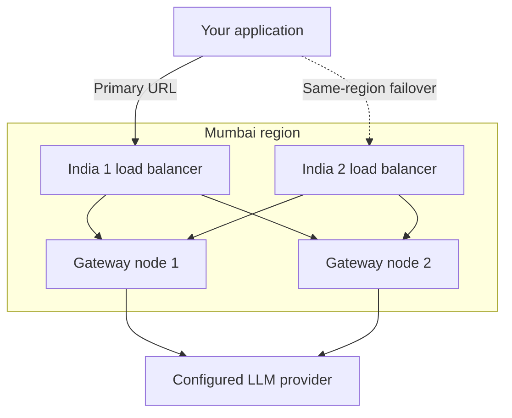

# HA & SLA

Updated on 4 November 2026.

Use regional gateway endpoints to keep requests in your assigned region and recover from a gateway node or load balancer failure. This guide covers endpoint selection, retry behavior, the uptime SLA and latency planning.

## Gateway Endpoints

Every endpoint supports the gateway API formats. Configuration, keys and limits apply per region: use the endpoints assigned to your organization.

| Endpoint | Region | Base URL |
|----------|--------|----------|
| **Global** | Global | `https://guardrails.quilr.ai` |
| **USA 1** | US Central West | `https://guardrails-usa-1.quilr.ai` |
| **USA 2** | US East | `https://guardrails-usa-2.quilr.ai` |
| **India 1** | Mumbai | `https://guardrails-india-1.quilr.ai` |
| **India 2** | Mumbai | `https://guardrails-india-2.quilr.ai` |
| **Japan** | Tokyo | `https://guardrails-jp-1.quilr.ai` |
| **Europe** | Europe | `https://guardrails-europe-1.quilr.ai` |

Append the API format path to the base URL, for example `https://guardrails-india-1.quilr.ai/openai_compatible/v1`. See the [Integration Guide](./integration-guide) for supported formats.

For production traffic, use your assigned regional endpoint. Use `guardrails.quilr.ai` only when your organization uses the global host, and keep it out of a regional failover chain.

## Routing Architecture

**A regional URL is a load balancer, not an individual gateway node.** It distributes requests across gateway nodes in that region. Each node runs the gateway pipeline, including validation, scanning, routing and logging.

A region may provide two separate load balancer URLs. The first distributes traffic across gateway nodes during normal operation. If that load balancer becomes unavailable, your application can switch to the second URL in the **same region**. Mumbai provides this pair today through **India 1** and **India 2**.



The diagram illustrates the routing pattern; node counts can change. Separate load balancers provide another entry point if one load balancer fails. They can still share gateway nodes and regional dependencies, so this does not protect against an entire regional outage or an upstream provider outage.

## Recommended Retry Strategy

Configure a primary and, where available, an alternate endpoint **within your assigned region**. Use only a pair supplied for that region. In particular, **USA 1 and USA 2 are different regions**, so they are not a same-region failover pair.

For a Mumbai deployment:

<StepFlow steps={[
  {
    label: "Primary attempt",
    items: [
      "guardrails-india-1.quilr.ai",
      "Load balancer selects a gateway node",
      "Mumbai region ✓",
    ],
  },
  {
    label: "Alternate attempt",
    items: [
      "guardrails-india-2.quilr.ai",
      "Separate load balancer entry point",
      "Same Mumbai region ✓",
    ],
  },
]} />

### Why retry with regional endpoints?

The load balancer handles distribution across gateway nodes behind its URL. Your application handles switching between the two load balancer URLs when an entry point is unavailable. Keep the alternate's credentials, configuration and provider access ready before an incident, and verify the pair during deployment.

Limit each call to one primary attempt and one alternate attempt. Apply a short backoff with jitter before the alternate attempt, and choose connection and response timeouts that fit your application's deadline.

| Outcome | Recommended behavior |
|---|---|
| Connection cannot be established | Try the alternate URL in the same region. |
| HTTP 502, 503 or 504 | Retry only when your application can safely replay the request. Honor `Retry-After` when present. |
| HTTP 429 | Respect `Retry-After` and the applicable quota or rate limit. Switching URLs does not provide additional quota. |
| Authentication error, invalid request or guardrail block | Return the error or policy outcome to the caller. |
| Read/write timeout or connection lost after sending | The request may already have reached the provider. Replay only if duplicate execution and charges are acceptable or your application can prevent them. |
| Stream fails after output starts | Handle the interrupted stream explicitly; a new request cannot resume the same generation. |

Use one retry layer. If your application implements endpoint failover around an SDK, disable the SDK's built-in retries, for example `max_retries=0` with the OpenAI Python SDK, so attempts do not multiply.

### Code Example

This non-streaming example switches to the alternate Mumbai URL only when a connection cannot be established. HTTP errors and failures after sending the request propagate to the caller for the handling described above.

```python
import os
import random
import time

import httpx

ENDPOINTS = [
    "https://guardrails-india-1.quilr.ai",  # primary Mumbai load balancer
    "https://guardrails-india-2.quilr.ai",  # alternate Mumbai load balancer
]


def call_llm(client: httpx.Client, payload: dict) -> dict:
    for attempt, base_url in enumerate(ENDPOINTS):
        try:
            response = client.post(
                f"{base_url}/openai_compatible/v1/chat/completions",
                json={**payload, "stream": False},
            )
        except (httpx.ConnectError, httpx.ConnectTimeout):
            if attempt == len(ENDPOINTS) - 1:
                raise
            time.sleep(random.uniform(0.1, 0.3))
            continue

        response.raise_for_status()
        return response.json()

    raise RuntimeError("No gateway endpoints configured")


# Reuse this client across calls to preserve connection pooling.
with httpx.Client(
    headers={"Authorization": f"Bearer {os.environ['QUILR_API_KEY']}"},
    timeout=httpx.Timeout(60.0, connect=3.0),
) as client:
    result = call_llm(client, {
        "model": os.environ["QUILR_MODEL"],
        "messages": [{"role": "user", "content": "Summarize this document."}],
    })
```

Replace the endpoint pair for a deployment in another region only with the pair assigned to that region.

## Data Residency Note

Keep gateway requests and failover within your organization's assigned region. The Mumbai example uses two load balancers in one region; it does not move traffic to another geography.

Your upstream provider deployment is a separate routing choice. Select provider deployments that meet your organization's data residency requirements as well.

## SLA

### Uptime

QuilrAI provides a contractual **99.6% uptime SLA** for the gateway. Your agreement defines the covered endpoints, measurement period, exclusions and applicable remedies.

Same-region endpoint failover improves resilience to an individual entry point failing. It does not change the contractual SLA or guarantee availability when shared regional dependencies or the upstream provider are unavailable.

### Gateway Latency

For capacity and response-time planning, use **50 ms median** and **94 ms average** of added gateway processing time with the default built-in text detections, at a reference size of **10,000 total scanned input and output tokens**. For example, 8,000 input tokens plus 2,000 output tokens count as 10,000 tokens.

| Default text scanning | Planning figure |
|---|---|
| **Median gateway overhead** | **50 ms per 10,000 total scanned tokens** |
| **Average gateway overhead** | **94 ms per 10,000 total scanned tokens** |
| **Configuration** | Default built-in data and adversarial detections; no custom detections, Guardian Agent, hallucination check, token-saving transforms or attachment scanning |
| **Excluded time** | Upstream model generation and client-to-gateway network time |

These are indicative planning figures, not a latency SLA or a controlled benchmark of exactly 10,000 scanned tokens. Production token usage is a proxy for scan size. Request/response split, caching, enabled checks, content complexity and concurrency affect actual time; latency does not scale at a fixed rate per token. See [default guardrail settings](../protect/security-guardrails#defaults-for-a-new-app).

#### Custom detections

Use these estimates when planning a scan with a simple custom category:

| Custom detection type | Estimated processing time |
|---|---|
| **EDM / regex** | **7-11 ms** |
| **Semantic** | **~50 ms** |
| **Intent** | **~150 ms** |

These are per-scan planning estimates, not measured incremental costs for every category at 10,000 tokens. Request-side and response-side scans are separate passes. Categories can share work and run in parallel, so do not multiply a row by the number of categories or add every row to predict total latency. Pattern complexity, text size and the number of categories can change the result. See [Custom detections](../protect/custom-detections).

#### Images and attachment scanning

Attachment scanning and Image Risks are off by default. The work below applies when the relevant protection is enabled and a request contains a file that needs that scan.

| Optional work | Expected time | Basis |
|---|---|---|
| **Image classification only** | **20-100 ms per image** | Planning estimate; limited independent samples. |
| **Image classification with OCR** | **~346 ms average; ~1.33 s p95 per completed image scan** | Observed worker time across 74 completed image scans. |
| **OCR** | **100-1,500 ms per image** | Planning estimate; depends on image size, quality and visible text. |
| **Native document text extraction** | **20-200 ms per file** | Planning estimate for a simple text-bearing document; insufficient production samples for a general document benchmark. |

The completed-image figures exclude timed-out and skipped scans, so they do not describe every attachment request. Allow for slower scans and check the recorded scan status. An incomplete scan is not a clean result; see [Actions and unreadable files](../protect/attachment-scanning#actions-and-unreadable-files).

These stages can overlap and are not all additive. Extracted text also passes through the enabled text detections, and that text contributes to the total scanned-token workload. Multi-page scanned PDFs require page-level OCR; the image figures are not a benchmark for a whole PDF. See [Attachment scanning](../protect/attachment-scanning).

#### Guardian Agent

[Guardian Agent](../protect/guardian-agent) is off by default. When enabled, use this additional latency budget:

| Optional check | Additional processing time | Basis |
|---|---|---|
| **Guardian Agent** | **350 ms median; 500 ms average per request** | Planning estimates on top of the default gateway overhead. |

These estimates apply per request, independently of the 10,000-token reference used for default text scanning. Enabled features, request complexity and external dependency lookups affect the result. Budget any extra model generation caused by a preliminary draft or corrective retry separately. With streaming dependency checks, the preliminary draft also delays the first token. See [Latency impact](../protect/guardian-agent#latency-impact).

### Connection Pooling & Performance Under Load

The gateway reuses connections to configured LLM providers, reducing repeated connection setup when a pooled connection is available. Reuse an HTTP or SDK client in your own application as well.

Connection pooling does not guarantee faster model generation or remove provider rate limits. Validate response-time budgets with your selected models, scan configuration, payload sizes and expected concurrency. Monitor median and tail latency separately, including time to first token for streaming requests.
